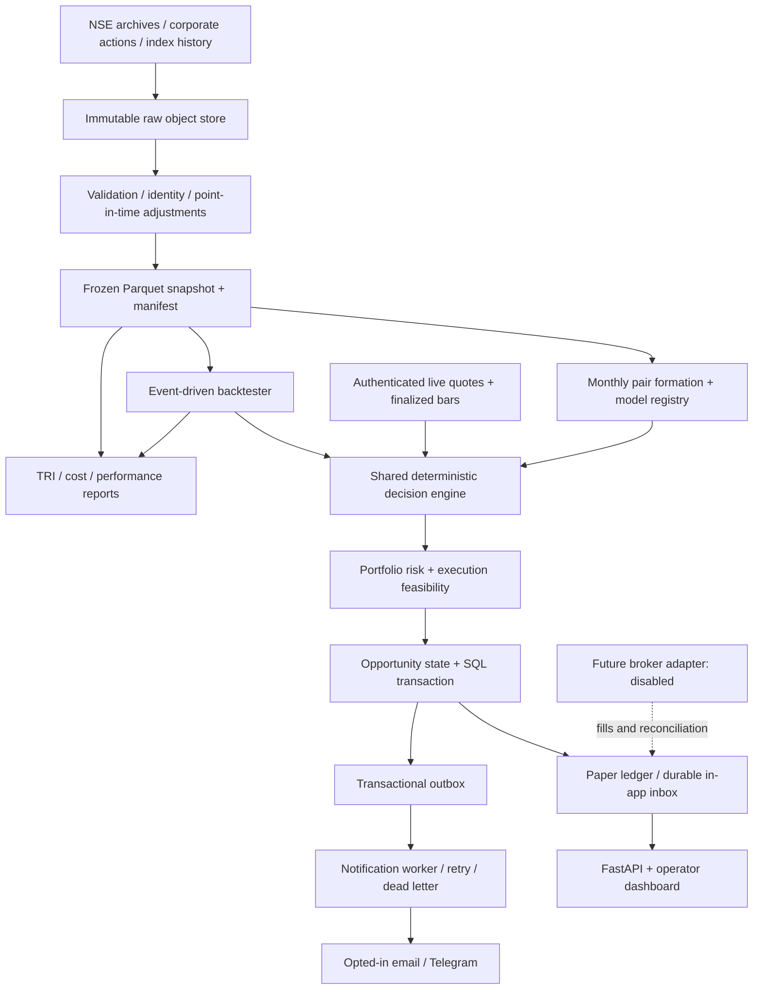

# Architecture decisions and operating flows

All components below are planned. No runtime infrastructure is deployed by this package.

## Decision records

ADR-001: Official exchange archives are the primary research provenance. Authentication-backed market data supports production freshness. A publicly reachable website is not treated as an SLA or redistribution grant.

ADR-002: Point-in-time identity/membership and raw/adjusted price separation precede model development. Historical membership cannot be inferred from the current constituent file.

ADR-003: Daily signals are the initial strategy. Intraday risk observations do not create a separately untested intraday entry rule.

ADR-004: Use a modular application and shared event contracts. Start with SQL transactions, object storage and a small number of workers. Adopt distributed systems only for measured load or isolation needs.

ADR-005: Store model artifacts, configuration and snapshot IDs in every decision. Research and streaming consume the same decision function. Stale models cannot be silently refitted while a trade is open.

ADR-006: Execution feasibility is independent of statistical qualification. Simulated spot shorts without borrow evidence are an explicitly labeled research scenario. Futures need actual contracts and integer lots.

ADR-007: Use a durable outbox and idempotent consumers. External notification delivery is at least once; broker orders require reconciliation before retry after ambiguous submission.

ADR-008: Live trading and external notifications are disabled in initial configuration. Development, paper and any later live account have separate credentials and explicit mode checks.

## Event envelope

Each event has event_id, schema_version, event_type, security/contract IDs, event_time_utc, available_at_utc, received_at_utc, source_id, sequence_or_revision, model_id when applicable, correlation_id and payload_hash. Decisions additionally carry data_snapshot_id, configuration_hash, code_commit and reason_codes.

An opportunity key is hash(strategy_version, model_id, canonical_pair_id, signal_session, direction, opportunity_type). A new provider message for the same opportunity must update delivery status rather than create a second logical trade. Material changes produce a linked revision.

## Failure responses

| Failure | Entry behavior | Existing position behavior |
| --- | --- | --- |
| Missing or unfinalized bar | No confirmed entry | Retain state; conservative mark; operational incident |
| Quote stale or clock invalid | Block execution-ready status | Escalate; use approved alternate observation/exit channel |
| Corporate action unresolved | Quarantine affected instruments | Review adjustment and route-specific exit obligation |
| Notification provider fails | Retain inbox and retry outbox | Escalate via configured independent channel |
| Margin or borrow unavailable | Block or reject pair | Controlled risk reduction using verified broker state |
| Model expires | Stop new entries | Manage existing holdings under frozen exit/risk policy |
| Broker submission uncertain | Never blindly resubmit | Reconcile IDs/fills, then repair or flatten exposed leg |
| Database restore | Read-only and pause | Reconcile durable ledger against broker before resume |

## Release topology

CI builds a locked, scanned container and runs accounting, chronology, data-contract and replay tests. A reviewed artifact moves to staging, then paper. Database migrations are reversible where possible and backed up before rollout. Candidate models deploy in shadow mode before replacing the active registry version. Rollback restores the prior approved model for new decisions while preserving actual fills and all open-position history.

No UI rollback or code restart may reset kill-switch state, position exposure, alert acknowledgments or order IDs.
